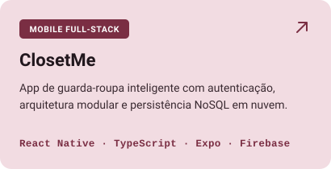
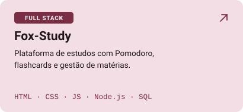
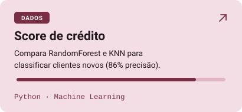
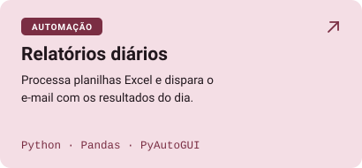
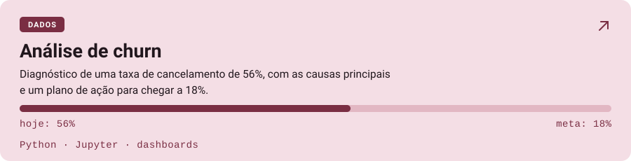
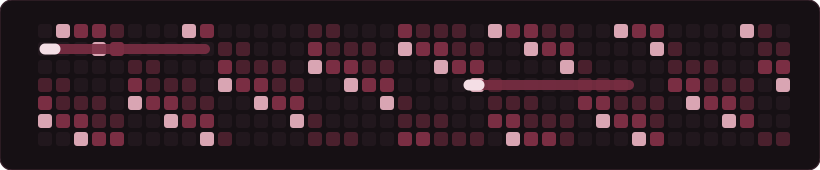

  

  
  

### 🎓 Sobre mim
- 🎓 Graduanda em Ciência da Computação pela Universidade Católica de Brasília (UCB).
- 💼 Estagiária de Desenvolvimento de Software com foco em **Engenharia de Software e Back-end**.
- 🛠️ Experiência no desenvolvimento de aplicações e APIs REST (Node.js, TypeScript, Python, React Native, SQL e NoSQL), testes automatizados e padronização de ambientes com Docker.
- 🚀 Diferencial em análise de dados (Pandas, Machine Learning) e automação de processos (RPA e ServiceNow) aplicados à construção de sistemas consistentes e escaláveis.

### 🛠️ Tecnologias e ferramentas

<h4>Engenharia de Software (Back-end)</h4>

<h4>Banco de Dados, Cloud e Ferramentas</h4>

<h4>Dados, Automação & IA (Diferencial Analítico)</h4>

### 🚀 Projetos

<table align="center">
  <tr>
    <td>
      
    </td>
    <td>
      
    </td>
  </tr>
  <tr>
    <td>
      
    </td>
    <td>
      
    </td>
  </tr>
</table>

  

### 📈 Atividade

  

  

