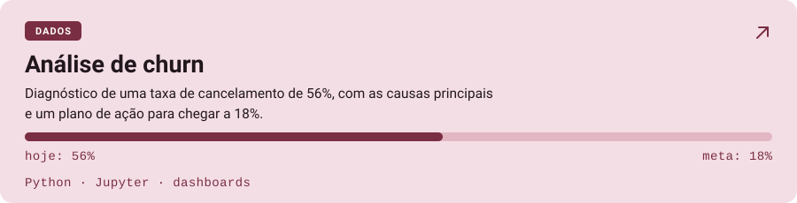
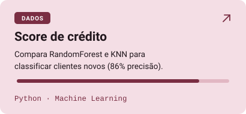
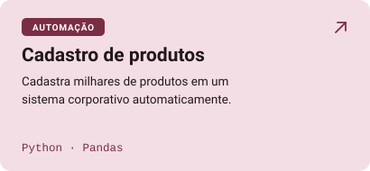
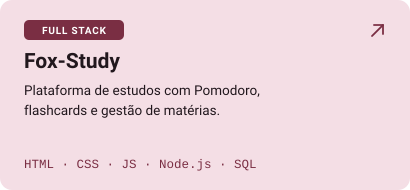
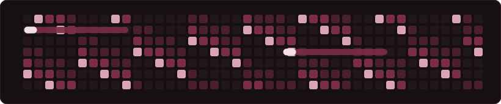

  

  
  

### 🎓 Sobre mim
- 🎓 Graduanda em Ciência da Computação pela Universidade Católica de Brasília (UCB).
- 💼 Estagiária de Desenvolvimento de Software.
- 🛠️ Experiência em análise de dados (Python, Pandas, SQL), automação de processos (RPA e ServiceNow), integração de APIs REST e desenvolvimento web.
- 💻 Gosto de tecnologia desde criança, e foi um projeto de score de crédito que me levou para dados.
- 🚀 Foco em criar soluções funcionais, otimizadas e aplicadas a problemas reais.

### 🛠️ Tecnologias e ferramentas

<h4>Dados</h4>

<h4>Automação</h4>

<h4>Back-end e mobile</h4>

<h4>Linguagens</h4>

<h4>Ferramentas e redes</h4>

### 🚀 Projetos

  

<table align="center">
  <tr>
    <td>
      
    </td>
    <td>
      
    </td>
  </tr>
  <tr>
    <td>
      
    </td>
    <td>
      
    </td>
  </tr>
</table>

### 📈 Atividade

  

  

